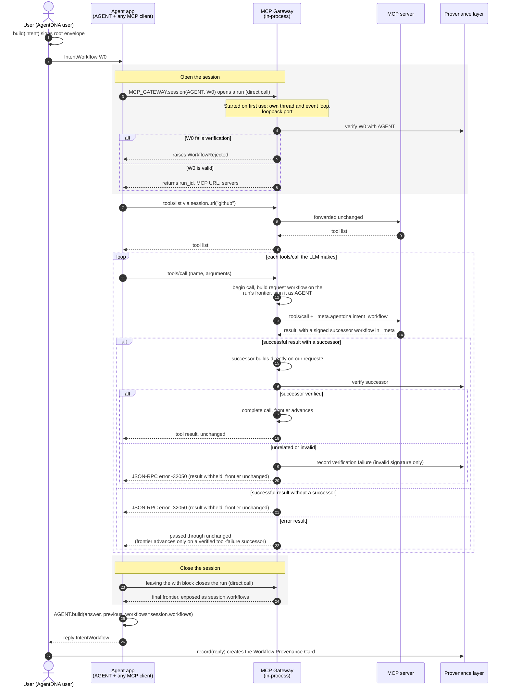

# AgentDNA MCP Gateway: Design

**Status:** v1 implemented in `agentdna/mcp/gateway/`. The GitHub repository
example (`examples/github_repository_agent`) uses it in place of the
client adapter.

## 1. Summary

The **AgentDNA MCP Gateway** sits between an agent's MCP client and an
upstream MCP server. For every `tools/call` it signs a request
`IntentWorkflow` as the agent, attaches it to `_meta`, verifies the
successor workflow the server returns and advances the causal frontier.
Everything else passes through unchanged.

Workflow propagation therefore happens at the protocol boundary. The agent
can use any Streamable HTTP MCP client, with no framework-specific patch
(`install_mcp_client`).

For a developer, the whole integration looks like this:

```py
from agentdna.mcp.gateway import MCPGateway

MCP_GATEWAY = MCPGateway({"github": "http://127.0.0.1:8011/mcp"})   # once per process

async with MCP_GATEWAY.session(AGENT, incoming_workflow) as session:   # verifies incoming_workflow
    tools = await load_tools(session.url("github"))                    # any MCP client, unpatched
    result = await agent.ainvoke(...)

reply = AGENT.build(payload=str(result), previous_workflows=session.workflows)
```

The gateway comes with `agent-dna` (no extra install) and runs **inside the
agent's process**, on a background thread, starting on first use. It holds no
identity of its own: each session verifies and signs with the `AgentDNA`
instance passed to it.

## 2. Problem

The client adapters (`agentdna.mcp.client.langchain`, `.crewai`) tie
workflow propagation to particular frameworks:

- Each new client needs its own adapter.
- Each adapter monkey-patches framework internals that can change under it.
- Clients without an adapter cannot take part at all.

The gateway removes that coupling.

## 3. Goals

| Goal | Status |
| ---- | ------ |
| Forward MCP requests to an upstream MCP server | Done (Streamable HTTP) |
| Create or continue an `IntentWorkflow` for each `tools/call` | Done |
| Carry it in `_meta` using the existing metadata format | Done |
| Preserve unrelated metadata | Done |
| Extract and verify successor workflows | Done |
| Causal continuity across sequential and concurrent calls, per run | Done |
| Reuse `AgentDNA` for identity, signing, serialisation and verification | Done |
| Keep transport separate from workflow logic | Done: `app.py` vs `propagation.py` |
| Minimal developer effort | Done: one `MCPGateway(...)` plus a `session` block; nothing extra to install, start or configure (§6) |
| Several agents per process | Done: one gateway, each session signing as the agent that opened it (§6) |
| Several MCP servers per agent | Done: named servers, one session and one frontier across them |

## 4. Architecture

```text
Agent application        (MCP_GATEWAY.session(AGENT, ...) does 1 and 3)
   │  1. open run  {workflows: [incoming IntentWorkflow]}
   │     ◀── {run_id, mcp_path, servers}
   │
   │  2. any MCP client ── /runs/{run_id}/mcp/{server} ──▶ ┌──────────────────────┐
   │                                                       │ AgentDNA MCP Gateway │──▶ MCP server "github"
   │                                                       │  ├─ HTTP pass-through │──▶ MCP server "jira"
   │                                                       │  ├─ propagation       │
   │                                                       │  ├─ runs (frontiers)  │◀──
   │                                                       │  └─ each run's agent  │
   │                                                       └──────────────────────┘
   │  3. close run
   │     ◀── {workflows: [final frontier]}
   ▼
AGENT.build(payload, previous_workflows=session.workflows)   # the final frontier
```

Steps 1 and 3 are direct calls into the gateway, in the agent's process:
there is no `/runs` endpoint. Step 2, the MCP traffic, is HTTP to a loopback
port chosen by the OS (§6).

The gateway understands MCP, not only HTTP. It parses JSON-RPC
messages in both `application/json` and `text/event-stream` responses so it
can find `tools/call` requests and their responses. Everything else is
forwarded byte for byte: `initialize`, `tools/list`, notifications, the GET
notification stream, `DELETE`, and `mcp-session-id` and other headers.

### 4.1 End-to-end flow

One agent execution, from the user's intent to the recorded reply, with the
in-process gateway. Overlapping tool calls follow the same path in parallel;
they share one parent frontier and merge in call-start order (§8).



## 5. Handing the workflow to the gateway: runs

This was the central open question. With the client adapters, the
agent sets `agentdna_context(AGENT, incoming_workflow)` and the adapter
reads it. The gateway sees only MCP traffic, which says nothing about which
agent execution it belongs to. And it cannot start a chain on its own:
`AgentDNA.build()` without a parent is allowed only for `user` actors.

**Decision: explicit, run-scoped URLs.**

1. The agent opens a run with its `AgentDNA` instance and the workflow(s)
   it received. The gateway verifies them with that agent before accepting.
2. The gateway returns an unguessable `run_id` (`secrets.token_urlsafe(24)`)
   and the run's MCP path `/runs/{run_id}/mcp`.
3. The agent points any MCP client at that URL. Every `tools/call` on it
   builds on, and advances, that run's frontier and no other.
4. The agent closes the run and receives the final frontier. That is the equivalent of `ctx.workflows`, and the agent
   builds its reply on it.

The developer never sees runs or frontiers directly. `GatewaySession`
(from `MCP_GATEWAY.session(AGENT, workflow)`) wraps them:

| Session API | Does |
| ----------- | ---- |
| `with` / `async with` | Opens the run (the incoming workflow is verified with `AGENT`; `WorkflowRejected` carries the status code on failure). On exit, closes it. If the block raised, it force-closes and lets the original exception propagate |
| `session.url(name)` | The MCP URL to give the agent's MCP client for that server (`url()` works when there is only one) |
| `session.workflows` | The final IntentWorkflow(s), once the session is closed: the incoming workflow plus every tool call. The agent builds its reply on them with `AGENT.build()`, as it did on `ctx.workflows` with the client adapters. Reading it while the session is open raises rather than returning the not-yet-final incoming workflow |
| `session.close()` / `await session.aclose()` | Closes early and returns the final workflows, for use inside the block |
| `session.frontier()` / `afrontier()` | The workflows produced so far, without closing |
| `session.agent` | The `AgentDNA` instance the session verifies and signs with |

Verification of the incoming workflow moved into the session. The agent no
longer calls `AGENT.verify()` itself for this; doing so would only verify the
workflow twice.

**Alternatives considered:**

| Option | Why not |
| ------ | ------- |
| MCP `mcp-session-id` as the run key | Sessions do not map to runs. `langchain-mcp-adapters` opens a new session per tool call by default, and long-lived clients reuse one session across unrelated tasks. |
| Workflow in a request header | Workflows grow with every hop and soon exceed header size limits. Many clients only let you set headers when the client is built. |
| Run ID in a header on a fixed `/mcp` URL | Needs per-run header support in the client. The path works with every client that accepts a URL. |
| Fully transparent (no hand-off) | Impossible without losing the user's root intent: the gateway has no parent to build on. |

**Run lifecycle:**
- Runs live in memory (`RunRegistry`).
- A run is dropped after `run_ttl_seconds` idle (default 3600), but never while a call is in flight.
- Closing a run with calls in flight is refused (`GatewayError`, status 409) unless forced. Leaving a `with` block because of an exception force-closes.

## 6. Where it runs, identity and signing

`MCPGateway(servers)` is cheap to create; nothing starts until the first
session. That session starts the gateway application (`embedded.py`) under
uvicorn, on a thread of its own with its own event loop, bound to `127.0.0.1`
on a port the OS picks. One gateway, one port, shared by all its sessions.

- **No identity of its own.** `session(AGENT, workflow)` verifies the
  incoming workflow with `AGENT` and signs every tool call in the session as
  `AGENT`, using that very instance. The gateway cannot sign as the wrong
  agent, and one gateway can serve several agents in a process (an
  orchestrator and its workers), each session signing as its own agent.
- **Own thread and loop.** The agent's MCP client calls the gateway over
  HTTP, and synchronous `session.close()` can be called even from async
  code. A gateway on the agent's own loop would deadlock.
  Runs survive across `asyncio.run()` calls.
- **No run endpoints.** Sessions open and close runs by calling the
  gateway's `RunService` directly, scheduled onto the gateway's event loop.
  That keeps a close atomic with the tool calls the loop is processing. There
  is no `/runs` endpoint, so nothing else on the machine can open a run and
  have tool calls signed as an agent, and there is no token to manage. The
  only HTTP surface is each run's MCP endpoint, reachable only through its
  unguessable URL.
- **Host application untouched.** uvicorn is started with `log_config=None`,
  so it does not reconfigure the host's logging. Signal handlers are not
  installed off the main thread. The server is stopped at exit, or with
  `MCP_GATEWAY.close()`.
- **Trust.** The agent process signs, as it did with the client adapters.

**Why in-process only.** A standalone sidecar (`agentdna-gateway`, configured
from the environment, runs opened over HTTP with a bearer token) was
prototyped and removed. It needed a separate install and process, its own
copy of the agent's identity kept in sync by name and config dir, and its own
endpoint security. In process, none of that exists, and signing stays in the
agent's process.

## 7. Request and response lifecycle

### Outgoing `tools/call`

1. Validate the request: `params` is an object, `name` is non-empty,
   `arguments` and `_meta` are objects. Otherwise return a JSON-RPC error
   and do not forward the request.
2. `begin_mcp_call()` on the run's `AgentDNAContext`.
3. `AgentDNA.build()` on the batch's parent frontier, with the canonical
   payload from `agentdna.mcp.payload.build_mcp_tool_call_payload`. The
   client adapters now import this same function, so the payload is
   identical whichever path a call takes.
4. Merge `workflow_to_metadata()` into `params._meta`. Unrelated keys and
   namespaces are preserved. The gateway owns `_meta.agentdna` and logs a
   warning if a client supplied one.
5. Forward the request upstream.

### Incoming response: the policy

The policy fails closed. A successful tool result reaches the agent only
after its successor has been verified.

| Upstream response | Agent receives | Frontier |
| ----------------- | -------------- | -------- |
| Success with a valid successor | Result unchanged (successor stays in `_meta`) | Advances |
| Success with no successor | JSON-RPC error `-32050` | Unchanged |
| Success, successor does not build directly on our request (wrong `id`, or no parent matching the request's hash and signature) | JSON-RPC error `-32050` | Unchanged |
| Success, successor fails `AgentDNA.verify()` | JSON-RPC error `-32050` with `data.agentdna_status_code`; the failure is built and recorded on the provenance layer, as the adapters do | Unchanged |
| `isError` with a `TOOL_EXECUTION_FAILED` successor | Result unchanged | Advances (the failure is part of the chain) |
| `isError` with no successor (the server refused the call before running the tool) | Result unchanged | Unchanged |
| JSON-RPC `error` | Unchanged | Unchanged |
| `resultType` other than `complete` (`input_required`, tasks) | Unchanged; the follow-up call gets its own workflow | Unchanged |
| HTTP ≥ 400, or a non-MCP content type | Passed through | Unchanged |
| Upstream unreachable | HTTP 502 with JSON-RPC error `-32050` | Unchanged |
| Stream ends early, or the client disconnects | n/a | Unchanged (shielded cancel) |

The "builds directly on our request" check is new: the client adapters
did not have it. Without it, a server could answer with any validly signed
workflow, such as a replay or one from another run.

Every pending call is resolved exactly once, either completed or cancelled,
on every path. `finish_tool_call` and `abandon_tool_call` guarantee this.

## 8. Causal context and concurrency

Each run owns an `AgentDNAContext`, which the gateway reuses unchanged.
Overlapping calls form a batch that shares one parent frontier. When every
call in the batch is resolved, the successful successors become the new
frontier, in the order the calls started.

Reviewing that code for the gateway exposed a bug in `MCPExecutionBatch`,
which also affected the client adapters. It is now fixed:

- **Cancel, then succeed:** the batch never completed. Every later call was
  built on the stale frontier, and the agent's reply lost every tool call.
- **Succeed, then cancel:** the whole batch was dropped, including the
  successful branch.

Now a cancelled call counts as resolved but adds nothing to the frontier. If
every call in a batch is cancelled, the frontier stays where it started.
Repeated and late cancels are ignored. Tests:
`tests/test_mcp_context.py`.

## 9. Metadata compatibility

The format is unchanged:

```json
{ "agentdna": { "intent_workflow": "<serialized IntentWorkflow>" } }
```

The gateway uses the existing helpers (`workflow_to_metadata`,
`workflow_from_metadata`, `AGENTDNA_META_KEY`).

This format is the gateway's whole contract with an MCP server. The server
reads the request workflow from `params._meta` and returns a signed successor
in the result's `_meta`. Requests from the gateway look exactly like requests
from the client adapters, so a server that already works with the adapters
needs no change.

## 10. Error handling and security

| Case | Behaviour |
| ---- | --------- |
| MCP request for an unknown or expired run, or unknown server name | `404`; nothing is forwarded upstream |
| Incoming workflow fails verification | `WorkflowRejected` (status 422, with `status_code`) |
| Verification cannot be performed | `GatewayError` (status 503) |
| Batched JSON-RPC containing `tools/call` | `400` (batching was removed from MCP 2025-06-18) |
| Signing fails | JSON-RPC error; the call is cancelled |
| Invalid server map or settings | `MCPGateway(...)` raises `ConfigError` |

**Security properties:**
- The gateway binds to `127.0.0.1`, on a port the OS picks.
- The gateway does no authorisation of tool calls: whether an agent may call
  a tool is for the MCP server to decide. What it protects is agents' signing
  identities. Opening a run means "sign tool calls as this agent", and
  workflows are not secret (they travel in `_meta` and are recorded), so a
  verified workflow alone must not be enough to open one. Runs can only be
  opened in process, by code holding the agent's `AgentDNA` instance (§6).
- The MCP endpoint is protected by the unguessable run ID.
- Request headers, including the agent's `Authorization` for the upstream,
  are forwarded unchanged except hop-by-hop headers and `accept-encoding`.
  Transport authentication stays separate from workflow verification.
- The gateway never logs headers, credentials or keys.

## 11. Configuration

Nothing is read from the environment. `MCPGateway` takes:

| Parameter | Description |
| --------- | ----------- |
| `servers` | Required. MCP server name to Streamable HTTP URL, e.g. `{"github": "http://127.0.0.1:8011/mcp"}`. Names may contain letters, digits, `-` and `_`. |
| `run_ttl_seconds` | Idle run expiry. Default `3600`. |
| `upstream_timeout_seconds` | Read timeout per upstream request. Default `300`; GET streams have no read timeout. |

The gateway comes with `pip install agent-dna`: `starlette` and `uvicorn` are
regular dependencies.

## 12. Module layout

```text
agentdna/mcp/payload.py          canonical tools/call payload (shared with the client adapters)
agentdna/mcp/gateway/
  __init__.py                    exports MCPGateway, GatewaySession, GatewayError, WorkflowRejected
  client.py                      MCPGateway / GatewaySession: the developer-facing API
  embedded.py                    the app under uvicorn on its own thread and loop
  service.py                     RunService: open / frontier / close, run on the gateway's loop
  config.py                      GatewayConfig and its validation
  runs.py                        Run / RunRegistry: one AgentDNAContext per run
  propagation.py                 transport-neutral build → inject → verify → advance
  app.py                         Starlette app: the Streamable HTTP pass-through
```

## 13. Decisions

| Question (from the original draft) | Decision |
| ---------------------------------- | -------- |
| First transport | Streamable HTTP. stdio is not supported yet. |
| Deployment | In process only; a standalone sidecar was prototyped and dropped (§6). |
| Identity | None of its own: each session verifies and signs with the agent passed to it (§6). |
| Several MCP servers | Named servers behind one gateway; one frontier per session across all of them. |
| Identifying and isolating runs | Explicit runs with unguessable, run-scoped URLs (§5). |
| Missing or invalid successor | Fail closed for successful results; pass error results through (§7). |
| Merge policy for concurrent branches | Successful successors in call-start order; cancelled calls contribute nothing (§8). |
| Reuse the existing context? | Yes, after fixing the batch bugs (§8). |
| Remote signing interface | Not needed: signing stays in the agent's process, with the session's own `AgentDNA` instance. |

## 14. Testing

- **`tests/test_gateway.py`** (47 tests, no network): a fake signer and a fake
  upstream drive every row of the §7 policy in both JSON and SSE. Also
  covered:
  - preservation of unrelated `_meta`;
  - pass-through of non-tool traffic;
  - the run lifecycle (TTL, close refused with calls in flight unless forced, unknown runs);
  - run isolation;
  - concurrent calls, including one failing alongside one succeeding;
  - one run spanning two MCP servers, with routing by name and a shared frontier;
  - the session API on a real in-process gateway: open, `url()`, `workflows` (final only once closed), `WorkflowRejected`, sync use, force-close on error;
  - one gateway serving two agents, each session signing as its own agent;
  - no `/runs` endpoints;
  - one OS-chosen port per gateway, reused by all its sessions, and two gateways in one process coexisting;
  - configuration validation.

  The suite was checked against mutations: disabling the "builds on our
  request" check, or reverting the context fix, makes tests fail.
- **`tests/test_gateway_e2e.py`** (real signatures on the provenance dev
  node, two real AgentDNA-enabled FastMCP servers, and a plain
  `fastmcp.Client`). It covers:
  - sequential, concurrent and failing calls across both servers; the
    agent's reply verifies in `heavy` mode;
  - synchronous use;
  - rejection of a tampered incoming workflow;
  - no run endpoints, and unknown runs never reaching a server.

  Only the servers' admin whitelist lookup is stubbed.
- **`tests/test_mcp_context.py`, `tests/test_unwrap.py`**: the SDK fixes in §8
  and §15.
- **GitHub example, run manually** (`langchain-mcp-adapters` 0.3.2,
  langgraph 1.2, mcp 1.x / fastmcp 3.x, in-process gateway): LangGraph's
  parallel tool calls went through an unpatched client and were signed with
  the agent's DID. The reply verified in heavy mode, and a second execution
  reused the same gateway thread. A scripted model and stand-in GitHub data were
  used; a run with a real LLM and a real GitHub token is still to be done.

## 15. SDK fixes made along the way

- **`MCPExecutionBatch` cancellation** (§8).
- **`IntentWorkflow.unwrap()` dropped branches.** It deduplicated envelopes
  by `hash`, which covers only an envelope's own content. A server's
  identical "success" answers to two concurrent calls in the same second
  shared a hash, so one answer and its whole branch disappeared. Because
  `verify_heavy` iterates `unwrap()`, that branch was never verified.
  Deduplication now uses `(hash, signature)`.
- **Duplicated payload builder.** `build_mcp_tool_call_payload` was copied in
  both adapters; it now lives in `agentdna/mcp/payload.py`.

## 16. Limitations and follow-ups

- **Signature model (needs a decision).** A signature commits to its
  parents' content hashes, not to their ancestry. An envelope with identical
  content but a different history could be substituted without breaking any
  signature. Fixing this means a Merkle-style hash, which changes the format
  of stored records.
- **Runs are per process.** They live in the gateway's memory, in the agent's
  process. A session cannot span processes, which matches how agent
  executions run.
- **No stdio transport.** Desktop MCP clients that launch servers over stdio
  cannot use the gateway yet. Having the gateway launch the server command
  itself and proxy its stdio is the likely shape.
- **Client adapters.** The RSS and SQLite examples still use
  `install_mcp_client`. Once they are migrated, the adapters in
  `agentdna/mcp/client/` can be removed. Before then, check CrewAI's
  failure handling: the adapter stops the crew via `ToolExecutionFailedError`,
  whereas through the gateway CrewAI sees a JSON-RPC error or an `isError`
  result.
- **Auth evidence.** The gateway sees the upstream's response status, so it
  could record `auth_status` for the server hop, which
  `mcp/server/observer.py` currently records as `unknown`. Not wired yet.
