# The MCP Gateway, from the inside

This tutorial walks through the code in `agentdna/mcp/gateway/`: what each
module does, how the classes connect, and what happens, function by
function, when an agent opens a session, makes MCP tool calls and closes the
session.

It is about the code. For the design decisions and the response policy, see
`agentdna-mcp-gateway-design.md` at the repository root.

## 1. What the gateway does

An agent's MCP tool calls must carry a signed `IntentWorkflow`, and the MCP
server's signed reply must be checked before the agent sees it. The gateway
does both without touching the agent's MCP client. It sits between the client
and the MCP servers as a small HTTP proxy that runs inside the agent's own
process.

```py
from agentdna.mcp.gateway import MCPGateway

MCP_GATEWAY = MCPGateway({"github": "http://127.0.0.1:8011/mcp"})  # once per process

async with MCP_GATEWAY.session(AGENT, incoming_workflow) as session:
    client = MultiServerMCPClient(
        {"github": {"transport": "streamable_http", "url": session.url("github")}}
    )
    ...  # the agent runs, calling tools

reply = AGENT.build(payload=answer, previous_workflows=session.workflows)
```

The rest of this tutorial explains what each of those lines sets in motion.

## 2. The modules

| Module | Main contents | Role |
|---|---|---|
| `__init__.py` | Re-exports `MCPGateway`, `GatewaySession`, `GatewayError`, `WorkflowRejected` | The public API |
| `client.py` | `MCPGateway`, `GatewaySession`, the errors, `_wait` / `_await` | What developers use. Starts the gateway, opens and closes runs, hands out URLs |
| `embedded.py` | `EmbeddedGateway` | Runs the HTTP app under uvicorn on its own thread and event loop |
| `app.py` | `create_app()` and the HTTP helpers | The Starlette app: one MCP endpoint per run and server, proxying to the real servers, plus the endpoints stdio proxies call (§13) |
| `propagation.py` | `begin_tool_call`, `finish_tool_call`, `abandon_tool_call`, `PendingCall` | The AgentDNA logic for one `tools/call`: sign on the way out, verify on the way back |
| `service.py` | `RunService`, the `RunError` family, `mcp_path()`, `stdio_path()` | Open, read and close runs. Called directly by sessions; there is no endpoint |
| `runs.py` | `Run`, `RunRegistry` | In-memory runs, each with its own causal state |
| `config.py` | `GatewayConfig`, `ConfigError` | The validated configuration |

The gateway also builds on modules outside the package:

| Module | Used for |
|---|---|
| `agentdna/mcp/context.py` | `AgentDNAContext`, `MCPExecutionBatch`, `MCPCallHandle`: one run's causal frontier and concurrent-call batches. The client adapters use the same code |
| `agentdna/mcp/metadata.py` | `workflow_to_metadata`, `workflow_from_metadata`: the `_meta.agentdna.intent_workflow` format |
| `agentdna/mcp/payload.py` | `build_mcp_tool_call_payload`: the canonical payload signed for a `tools/call` |
| `agentdna/core.py` | `AgentDNA.build()` / `.verify()` / `.record()`: signing, verification and recording, always with the session's agent |
| `agentdna/mcp/stdio/` | The stdio proxy and its launch parameters (`StdioServer`, `wrap()`), for MCP servers the client launches as subprocesses (§13) |

## 3. How the classes connect

```mermaid
classDiagram
    direction LR
    class MCPGateway {
        -GatewayConfig _config
        -EmbeddedGateway _embedded
        +session(agent, workflows) GatewaySession
        +close()
        -_gateway() EmbeddedGateway
    }
    class GatewaySession {
        +AgentDNA agent
        +str run_id
        +list servers
        +url(server) str
        +workflows
        +open() / aopen()
        +close() / aclose()
        +frontier() / afrontier()
    }
    class EmbeddedGateway {
        +str url
        +RunService service
        +submit(coroutine) Future
        +stop()
    }
    class RunService {
        +servers
        +open(agent, workflows) Run
        +frontier(run_id) Run
        +close(run_id, force) list
    }
    class RunRegistry {
        +create(dna, workflows) Run
        +get(run_id) Run
        +remove(run_id) Run
    }
    class Run {
        +str run_id
        +AgentDNAContext context
        +calls_in_flight
    }
    class AgentDNAContext {
        +AgentDNA dna
        +list workflows
        +MCPExecutionBatch active_mcp_batch
        +begin_mcp_call() MCPCallHandle
        +complete_mcp_call(handle, workflow)
        +cancel_mcp_call(handle)
    }
    class MCPExecutionBatch {
        +list parent_frontier
        +dict completed_workflows
        +set cancelled_calls
        +terminal_frontier() list
    }
    class PendingCall {
        +Run run
        +MCPCallHandle handle
        +request_id
        +IntentWorkflow request_workflow
        +bool resolved
    }
    MCPGateway "1" --> "0..1" EmbeddedGateway : starts on first session
    MCPGateway "1" --> "*" GatewaySession : creates
    GatewaySession --> EmbeddedGateway : submits run operations
    EmbeddedGateway "1" --> "1" RunService : holds (from the app)
    RunService --> RunRegistry : stores runs
    RunRegistry "1" --> "*" Run
    Run "1" --> "1" AgentDNAContext : causal state
    AgentDNAContext "1" --> "0..1" MCPExecutionBatch : overlapping calls
    PendingCall --> Run
    PendingCall --> MCPExecutionBatch : via its MCPCallHandle
```



In words:

- **`MCPGateway`** is created once per process. It holds a `GatewayConfig`,
  and on the first session it starts one `EmbeddedGateway`, which it keeps
  until `close()`.
- **`GatewaySession`** is one agent execution. It holds the agent's
  `AgentDNA` instance and, once open, the run's ID. It never touches a run
  directly: every operation goes through the gateway's `RunService`, on the
  gateway's thread.
- **`EmbeddedGateway`** owns the server thread and exposes two things: the
  app's `RunService` (as `service`) and `submit()`, which schedules work on
  the gateway's event loop.
- **`RunService`** is the only code that opens and closes runs. It keeps
  them in a `RunRegistry`.
- **`Run`** pairs an unguessable ID with an `AgentDNAContext`. That context
  holds the agent to sign as, the current frontier, and the batch of calls in
  flight.
- **`PendingCall`** exists only while one `tools/call` is in flight. It ties
  the call to its run, its slot in the batch (`MCPCallHandle`) and the
  workflow it was signed with.

## 4. Two threads, two event loops

The thread layout is the most important thing to understand about the
gateway.

```text
agent's process
├── agent thread(s)          your code, the LLM loop, the MCP client
│     │  GatewaySession.open/close/frontier  ──submit()──┐
│     │                                                   ▼
│     │  MCP client ── HTTP 127.0.0.1:<port>/runs/{id}/mcp/{server} ──┐
│     │                                                               │
└── thread "agentdna-mcp-gateway"  uvicorn + Starlette, its own loop ◀┘
          ├── RunService (runs opened/closed here)
          ├── the mcp() endpoint (tool calls signed/verified here)
          └── httpx.AsyncClient ──▶ the real MCP servers
```

The gateway runs on its own thread and loop for three reasons:

- **No deadlock.** A synchronous `with` session in async code blocks the
  agent's loop while waiting for the gateway. If the gateway shared that
  loop, it could never answer.
- **Everything on one loop.** Every run operation (`RunService.open`,
  `close`, `frontier`) and every tool call runs on the gateway's loop, so
  closing a run is atomic with respect to the calls in flight. Closing never
  races a call that is halfway through. `AgentDNAContext.lock` (an
  `asyncio.Lock`) is only ever used on that one loop.
- **Survives `asyncio.run()`.** The gateway outlives any one of the agent's
  event loops, so separate `asyncio.run()` calls can share it.

Crossing from the agent's thread to the gateway's goes through
`EmbeddedGateway.submit(coroutine)`, which wraps
`asyncio.run_coroutine_threadsafe(coroutine, loop)` and returns a
`concurrent.futures.Future`. `client.py` waits on that future in one of two
ways:

- `_wait()` blocks on `.result()`, for synchronous `with` blocks.
- `_await()` uses `asyncio.wrap_future()`, for `async with` blocks.

Both turn a `RunError` raised on the gateway's side into the public
`GatewayError` / `WorkflowRejected` (§9).

Signing and verification (`AgentDNA.build` / `.verify`) are synchronous and
may hit the network. The gateway runs them with `asyncio.to_thread()`, so
they don't block its loop.

**One port, many concurrent requests.** The gateway listens on a single
port, and that is enough:

- A TCP connection is identified by client address, client port, server
  address and server port, so any number of connections share the server's
  one port.
- uvicorn accepts each connection and serves them all concurrently on the
  gateway's event loop. While one request waits on an MCP server or on
  signing, the others proceed.
- Requests are matched to sessions by the run ID in the URL path, not by
  port.
- The practical limit on parallel signing and verification is the default
  `asyncio.to_thread()` worker pool (`min(32, CPU count + 4)` threads).
  Beyond that, calls queue rather than fail.

## 5. Walkthrough: one session, start to finish

### 5.1 `MCPGateway(servers)`: configuration only

`MCPGateway.__init__` builds a `GatewayConfig(upstreams=servers, ...)` and
stops. Nothing starts and no port opens.

`GatewayConfig.__post_init__` validates everything up front and raises
`ConfigError`:

- names match `[A-Za-z0-9_-]{1,64}`, because they become URL path segments;
- URLs are `http(s)`;
- the port is valid (0 means the OS picks one);
- the timeouts are positive.

It also copies `upstreams` into a private dict, so the caller can't change it
under a running gateway. The map may be empty: `MCPGateway()` works for an
agent whose MCP servers are all launched over stdio (§13).

### 5.2 `MCP_GATEWAY.session(agent, workflows)`: a handle, not a run

This returns a `GatewaySession(gateway, agent, workflows)`. A single workflow
is wrapped in a list. Nothing is verified or opened yet; that happens on
entering the `with` block.

### 5.3 Entering the block: the gateway starts, the run opens

`__aenter__` → `aopen()` (or `__enter__` → `open()`):

1. **`_begin()`** checks the session isn't already open, then calls
   `MCPGateway._gateway()`.
2. **`MCPGateway._gateway()`**, under a lock, creates the `EmbeddedGateway`
   the first time, and returns the same one after that.
3. **`EmbeddedGateway.__init__`** (first time only):
   - binds a socket to `127.0.0.1` with port `0`. Port 0 is not a port the
     gateway listens on: it asks the OS to assign any free port from its
     ephemeral range (e.g. 32768–60999 on Linux), which is never a privileged
     port (1–1023). The gateway reads the assigned port back with
     `sock.getsockname()` and records `self.url`, e.g.
     `http://127.0.0.1:36617`;
   - calls `create_app(config)`, which builds the `RunRegistry`, the
     `RunService` and the Starlette app (§6), and keeps
     `app.state.service`;
   - starts `uvicorn.Server(...).run(sockets=[sock])` on a daemon thread
     named `agentdna-mcp-gateway`. It passes `log_config=None` so the host
     application's logging is untouched, and `access_log=False`;
   - waits until `server.started`, up to 10 seconds, then reads
     `app.state.loop`. The app's lifespan set it on startup;
   - registers `stop()` with `atexit`.
4. **`RunService.open(agent, workflows)`** runs on the gateway's loop:
   - verifies each workflow with `agent.verify()` in a worker thread;
   - a non-OK code raises `WorkflowFailedVerification`; an exception raises
     `VerificationUnavailable`;
   - then calls `RunRegistry.create(agent, workflows)`.
5. **`RunRegistry.create`** makes a
   `Run(run_id=secrets.token_urlsafe(24), context=AgentDNAContext(dna=agent, workflows=...))`.
   It first drops expired runs, then stores the new one. The incoming
   workflows are the run's first frontier.
6. **Back on the agent's thread**, `GatewaySession._opened()` records the
   embedded gateway, `run_id`, the server names and the URL base:
   `{embedded.url}/runs/{run_id}/mcp` (`mcp_path()`).

### 5.4 `session.url("github")`

This returns `{base}/github`. The name must be one of `session.servers`,
otherwise it raises `KeyError`. With exactly one server, `url()` needs no
name. This URL is the only thing the agent's MCP client ever sees.

### 5.5 A tool call goes out

The agent's MCP client POSTs a JSON-RPC message to the session URL.
Starlette routes it to the `mcp()` handler inside `create_app()`:

1. **Find the run and server.** `runs.get(run_id)` also marks the run as
   used. An unknown run or server name gets a `404`, and nothing goes
   upstream.
2. **Parse the body.** A JSON array containing a `tools/call` gets a `400`,
   because batching was removed from MCP. Anything that isn't a `tools/call`
   skips straight to step 5.
3. **`propagation.begin_tool_call(run, message)`** signs the call:
   - It validates the request: `params` is an object, `name` is non-empty,
     and `arguments` and `_meta` are objects. Otherwise it raises
     `ToolCallRejected`, which the handler answers with a `400` JSON-RPC
     error.
   - It calls `run.context.begin_mcp_call()`, which returns an
     `MCPCallHandle`: a slot in the current batch (§7).
   - It calls `agent.build(payload=build_mcp_tool_call_payload(name, arguments), previous_workflows=batch.parent_frontier)`,
     the agent signing the request on the frontier its batch started from.
     If signing fails, the slot is cancelled and the handler returns a
     JSON-RPC error.
   - It merges `workflow_to_metadata(request_workflow)` into `params._meta`.
     Other `_meta` keys stay. `_meta.agentdna` belongs to the gateway, and a
     client-supplied value is overwritten with a warning.
   - It returns a `PendingCall(run, handle, request_id, request_workflow)`.
4. **Re-serialise the message** with the signed `_meta`.
5. **Forward it upstream** with the shared `httpx.AsyncClient`, streaming the
   response:
   - Request headers, including the agent's own `Authorization` for the
     server, pass through. Hop-by-hop headers and `accept-encoding` are
     dropped (`_forward_headers`).
   - The read timeout is `upstream_timeout_seconds`, or none for a `GET`, the
     server's long-lived notification stream (`_timeout`).
   - If the server is unreachable, the call is abandoned and the client gets
     a `502` with a JSON-RPC error.
6. **Messages that aren't tool calls** are streamed back untouched
   (`_stream_through`): `initialize`, `tools/list`, notifications, `GET`,
   `DELETE`.

### 5.6 The answer comes back

`_tool_call_response(run, pending, upstream_response)` decides how to read
the answer:

- **HTTP ≥ 400, or neither JSON nor SSE.** It isn't an answer to the call.
  The call is abandoned and the response passed through.
- **`application/json`.** The body is read, and `finish_tool_call()` runs if
  it's the response to this call's `id` (`is_response_to`). The result is
  returned as JSON.
- **`text/event-stream`.** `_rewrite_sse()` streams the events as they
  arrive and passes each one to `_sse_event()`. Only the event carrying this
  call's response is rewritten; progress notifications pass through
  untouched. A `finally` clause abandons the call under
  `anyio.CancelScope(shield=True)`, so a client that disconnects mid-stream
  still resolves it.

`propagation.finish_tool_call(pending, response)` always resolves the call:
it runs `_finish()`, then `abandon_tool_call()`, which does nothing if
`_finish()` already completed it. `_finish()` applies the policy:

| Response | Outcome |
|---|---|
| JSON-RPC `error` | Returned unchanged; the call is cancelled |
| No `result` object | `_reject` → JSON-RPC error `-32050` |
| `resultType` not `complete` (`input_required`, tasks) | Returned unchanged; cancelled |
| `isError` with no successor, or a status other than `TOOL_EXECUTION_FAILED` | Returned unchanged; cancelled |
| Success (or a tool failure) with no successor | `_reject` |
| Successor that doesn't build on our request (`_descends_from` is false) | `_reject` |
| `agent.verify(successor)` raises | `_reject` |
| `agent.verify(successor)` fails | `_record_verification_failure()` signs and records the failure, then `_reject` (with `agentdna_status_code`) |
| Verified successor | `context.complete_mcp_call(handle, successor)`; the result returns unchanged, successor still in `_meta` |

`_descends_from(successor, request_workflow)` checks two things: the
successor has the same workflow ID, and its tip lists our request envelope
(same hash and signature) as a parent. Without it, a server could answer with
any validly signed workflow, such as a replay or one from another run.

`_reject()` builds a JSON-RPC error with code `AGENTDNA_GATEWAY_ERROR`
(`-32050`). The agent sees an ordinary failed tool call, so a result that
can't be verified never reaches it.

### 5.7 Leaving the block: the run closes

`__aexit__` → `aclose()` (or `close()`):

- **`RunService.close(run_id, force)`** runs on the gateway's loop. If calls
  are in flight and `force` is false, it raises `CallsInFlight`. Otherwise it
  removes the run from the registry and returns `context.get_workflows()`,
  the final frontier.
- **`GatewaySession._closed()`** stores those workflows and marks the session
  closed.
- **If the block raised**, `__exit__` / `__aexit__` closes with `force=True`
  and swallows any error from the close, so the original exception
  propagates.

`session.workflows` is a property that raises while the session is open.
Before closing, the stored list is still the incoming workflow, and building
a reply on it would silently drop every tool call. After closing, it returns
the final frontier, which the agent builds its reply on.

### 5.8 Shutdown

`MCPGateway.close()` calls `EmbeddedGateway.stop()`, which sets
`server.should_exit` and joins the thread. The same `stop()` runs at exit
through `atexit`. A run that is never closed is dropped by
`RunRegistry._purge_expired()` once idle for `run_ttl_seconds`, but never
while a call is in flight.

## 6. `create_app()` in detail

`create_app(config, upstream=None)` builds everything the HTTP side needs and
returns the Starlette app:

| Built | Where it ends up | Used by |
|---|---|---|
| `RunRegistry(ttl_seconds=...)` | `app.state.runs` | `RunService`, and `mcp()` to look up runs |
| `RunService(config, runs)` | `app.state.service` | `EmbeddedGateway.service`, and from there `GatewaySession` |
| The running event loop | `app.state.loop` (set in the lifespan) | `EmbeddedGateway.submit()` |
| `httpx.AsyncClient` | `app.state.upstream` (lifespan-owned, or injected for tests) | `mcp()` to reach the MCP servers |

The routes are:

- `/runs/{run_id}/mcp/{server}` and the same with a trailing slash, both
  accepting `GET`, `POST` and `DELETE`: the MCP pass-through.
- `/runs/{run_id}/stdio/calls` and `/runs/{run_id}/stdio/calls/{call_id}`:
  what stdio proxies call to have a `tools/call` signed and verified (§13).

There is no route for opening, reading or closing runs; that is deliberate
(§10).

## 7. Concurrency: the batch model (`agentdna/mcp/context.py`)

Agents often call several tools at once. The run's `AgentDNAContext` decides
what each call is signed on top of, and what the frontier becomes afterwards.

- **The first call to begin** while no batch is active creates an
  `MCPExecutionBatch`, with `parent_frontier` set to a snapshot of the
  current frontier.
- **Calls that begin while that batch is still active** join it.
  `allocate_call()` gives each a sequence number, in start order. Every call
  in the batch signs on the same `parent_frontier`.
- **Each call ends exactly once:**
  - `complete_mcp_call(handle, successor)` records the successor
    (`record_completion`);
  - `cancel_mcp_call(handle)` records a cancellation (`record_cancellation`).
    A repeated or late cancel is ignored.
- **When every call in the batch has ended** (`complete`),
  `_close_batch_if_complete()` sets the frontier to the successful
  successors, in start order (`terminal_frontier()`), and clears the batch.
  If every call was cancelled, the frontier stays where it started.

Here is a timeline with two overlapping calls, A and B, followed by C:

```text
frontier: [W0]
A begins  → batch{parent=[W0]}, seq 0        A signs on W0
B begins  → joins the batch, seq 1           B signs on W0
B fails   → cancelled (no successor)
A answers → completed with A'                batch done → frontier: [A']
C begins  → new batch{parent=[A']}           C signs on A'
```

`PendingCall.resolved` and the `finally` clauses in `finish_tool_call` and
`_rewrite_sse` guarantee every call ends exactly once. A call that never
ended would leave the batch open forever, and with it every later call's
parent frontier.

## 8. The run lifecycle (`runs.py`)

- **`Run.calls_in_flight`** is the active batch's `active_calls`, or 0.
- **`RunRegistry`** is a dict guarded by a `threading.Lock`. `create()` and
  `get()` drop expired runs first, so there is no background cleanup thread.
  `get()` marks the run as used (`touch()`).
- **A run's ID** is the only thing linking an MCP request to it. Knowing the
  ID is what lets a request be signed for that run (§10).

## 9. Errors

The gateway raises errors in two places, on two different paths.

**Run operations**, called directly from the session:

| Raised in `service.py` | `status` | What the developer sees |
|---|---|---|
| `WorkflowFailedVerification` (with `status_code`) | 422 | `WorkflowRejected`; `.status_code` is the AgentDNA verification code |
| `VerificationUnavailable` | 503 | `GatewayError` |
| `RunNotFound` | 404 | `GatewayError` |
| `CallsInFlight` | 409 | `GatewayError` |

`client._error()` does the mapping. It puts the message and details in
`.body`, and `.status` mirrors the HTTP status the same failure would have
had.

**MCP traffic**, seen by the agent's MCP client:

| Situation | Response |
|---|---|
| Unknown run or server name | HTTP `404`, `{"error": ...}` |
| Batched JSON-RPC containing `tools/call` | HTTP `400`, JSON-RPC error |
| Malformed `tools/call` (`ToolCallRejected`) | HTTP `400`, JSON-RPC error |
| Signing failed | HTTP `200`, JSON-RPC error |
| Upstream unreachable | HTTP `502`, JSON-RPC error |
| Result withheld by policy (§5.6) | Upstream status, JSON-RPC error `-32050` |

## 10. Security, in code terms

- **No endpoint opens a run.** `create_app()` has no `/runs` route, and
  `RunService` is reached only through `EmbeddedGateway.service`, from code
  that holds the agent's `AgentDNA` instance. Nothing else on the machine can
  get tool calls signed as an agent.
- **The run ID is a bearer secret** (`secrets.token_urlsafe(24)`). It is the
  only authority on the MCP endpoint.
- **Loopback only.** `GatewayConfig.host` defaults to `127.0.0.1`, and
  `MCPGateway` never changes it.
- **No identity of its own.** Every signature and verification uses the
  `AgentDNA` instance of the session that opened the run (`Run.context.dna`).
  One gateway can serve several agents, each signing as itself.
- **The gateway doesn't authorise tool calls.** It forwards the agent's
  headers, including `Authorization`, unchanged. Whether a call is allowed is
  for the MCP server to decide.
- **Fail-closed.** A successful result whose successor is missing, unrelated
  or invalid is withheld (§5.6).

## 11. Where to make changes

| To change... | Look at |
|---|---|
| What counts as an acceptable server reply | `propagation._finish()` and `_descends_from()` |
| What is signed for a `tools/call` | `agentdna/mcp/payload.py` (shared with the client adapters, so they stay identical) |
| How concurrent calls merge | `agentdna/mcp/context.py` (`MCPExecutionBatch`, `_close_batch_if_complete`) |
| How responses are read (JSON vs SSE) | `app._tool_call_response()`, `_rewrite_sse()`, `_sse_event()` |
| Which headers pass through | `_REQUEST_HEADERS_DROPPED` / `_RESPONSE_HEADERS_DROPPED` in `app.py` |
| Session lifetime and expiry | `RunRegistry` (`runs.py`), `run_ttl_seconds` |
| How stdio servers are relayed | `agentdna/mcp/stdio/proxy.py` (`StdioProxy`) and the `stdio_*` handlers in `create_app()` |
| Another transport | Keep `propagation.py` and `service.py`; add a transport layer that hands parsed JSON-RPC messages to `begin_tool_call` / `finish_tool_call`, as the stdio endpoints do |

`propagation.py` never sees HTTP. It works on parsed JSON-RPC dicts, which
is what made stdio a contained change (§13).

## 12. Tests

| File | What it exercises |
|---|---|
| `tests/test_gateway.py` | No network. A fake signer (`FakeDNA`) and a fake MCP server (`Upstream`, a Starlette app) drive every row of the §5.6 policy, in JSON and SSE. Also: `_meta` preservation, pass-through, the run lifecycle, concurrency, multiple servers, the session API on a real in-process gateway, and ports |
| `tests/test_gateway_e2e.py` | Real AgentDNA signing on the provenance dev node, two real FastMCP servers with the AgentDNA middleware, and a plain `fastmcp.Client` |
| `tests/test_mcp_context.py` | The batch model in §7, including the cancellation cases |
| `tests/test_stdio.py` | No network. The real stdio proxy, launched from `session.stdio_server(...)` and driven over its stdin and stdout, in front of `tests/stdio_fake_server.py` (a line-based JSON-RPC server that signs like `FakeDNA`) |
| `tests/test_gateway_e2e.py` (stdio) | A real FastMCP stdio server with the AgentDNA middleware (`tests/stdio_agentdna_server.py`), launched by a real `fastmcp.Client` through the proxy, in the same session as an HTTP server |

To test the HTTP side without a server, build the app with
`create_app(config, upstream=httpx.AsyncClient(transport=httpx.ASGITransport(app=fake_upstream)))`,
open runs through `app.state.service`, and send MCP requests with an
`httpx.AsyncClient` on `ASGITransport(app=gateway_app)`. That is what the
`Harness` in `tests/test_gateway.py` does.

## 13. MCP servers launched over stdio (`agentdna/mcp/stdio/`)

With stdio, the agent's MCP client launches the server as a child process and
exchanges newline-delimited JSON-RPC over its stdin and stdout. There is no URL
to point at the gateway, so the gateway hooks in through the command the client
launches.

```text
agent process                                  child processes (launched by the MCP client)
┌───────────────────────────────┐
│ MCP client ─────stdio──────────┼──▶ stdio proxy ──stdio──▶ MCP server
│                                │        │
│ gateway thread                 │        │ tools/call only
│  /runs/{id}/stdio/calls ◀──────┼────────┘ (HTTP, loopback)
│  begin_tool_call / finish_...  │
└───────────────────────────────┘
```

### 13.1 Launch parameters: `GatewaySession.stdio_server()`

`session.stdio_server(command, args, env)` calls `launch.wrap()` with the
session's stdio endpoint (`{gateway url}/runs/{run_id}/stdio`, from
`stdio_path()`). It returns a `StdioServer(command, args, env)`:

- **`command`:** `sys.executable`, the agent's own Python.
- **`args`:** `["-m", "agentdna.mcp.stdio", "--", <resolved server command>, *args]`.
  The server command is resolved to an absolute path with `shutil.which`, so
  the proxy still finds it when a client launches stdio servers with a
  minimal `PATH`.
- **`env`:** the server's own `env`, plus `AGENTDNA_STDIO_ENDPOINT` set to the
  endpoint. The run ID is a bearer secret, so it travels in the environment,
  which only the same user can read. It is never placed in the arguments,
  which every local user can see with `ps`.

### 13.2 The proxy: `python -m agentdna.mcp.stdio -- <server command>`

`__main__.main()` reads the endpoint from the environment, exiting with code 2
if it's missing, then runs `proxy.run_proxy(endpoint, command)`:

1. Start the real server with
   `asyncio.create_subprocess_exec(..., stdin=PIPE, stdout=PIPE)`. Its stderr
   goes wherever the proxy's does. Lines may be up to 64 MiB
   (`MAX_LINE_BYTES`), because tool results can be large.
2. Install SIGTERM and SIGINT handlers that terminate the server, so stopping
   the proxy stops the server.
3. Read the proxy's own stdin (the MCP client) through an asyncio pipe, and run
   two relays concurrently on one `StdioProxy`:
   - **`from_client()`:** each line from the client.
     - A `tools/call` goes to `_begin()`: `POST {endpoint}/calls` with the
       message. On success, the gateway returns the signed message and a
       `call_id`; the proxy records `pending[id] = call_id` and forwards the
       signed message to the server. If the gateway refuses or can't be
       reached, the client gets a JSON-RPC error and nothing goes to the
       server.
     - A batch containing a `tools/call` gets an error.
     - Anything else is forwarded as is.
     - When the client closes stdin, the proxy closes the server's stdin.
   - **`from_server()`:** each line from the server.
     - A response whose `id` is in `pending` goes to `_finish()`, run as its
       own task so other messages keep flowing: `POST {endpoint}/calls/{call_id}`
       with the answer. The client gets what the gateway returns, either the
       original result or a JSON-RPC error if the result was withheld. If the
       gateway can't be reached, the result is withheld.
     - Everything else (notifications, progress, responses to other requests,
       requests the server makes of the client) is forwarded as is.
4. When the server closes its stdout (it exited):
   - wait for any `_finish()` tasks still running;
   - stop the client relay;
   - `abandon_pending()`: `DELETE {endpoint}/calls/{call_id}` for every call
     the server never answered, so nothing is left in flight;
   - exit with the server's exit code.

Writes to the client go through a lock, so concurrent `_finish()` tasks never
interleave lines. Nothing but protocol is ever written to stdout; diagnostics
go to stderr. The proxy is POSIX-only.

### 13.3 The gateway side: the `stdio_*` handlers in `create_app()`

| Route | Handler | Does |
|---|---|---|
| `POST /runs/{run_id}/stdio/calls` | `stdio_begin` | `begin_tool_call(run, message)`, stores the `PendingCall` in `run.stdio_calls[call_id]`, and returns `{call_id, message}`. If signing fails, it returns `{"error": <JSON-RPC error>}` for the proxy to pass on |
| `POST /runs/{run_id}/stdio/calls/{call_id}` | `stdio_finish` | Pops the `PendingCall` and returns `{"message": finish_tool_call(pending, response)}`. A response with the wrong `id` abandons the call |
| `DELETE /runs/{run_id}/stdio/calls/{call_id}` | `stdio_abandon` | Pops the `PendingCall` and calls `abandon_tool_call(pending)`. Always `204` |

A stdio call therefore goes through the same `begin_tool_call`,
`finish_tool_call` and `abandon_tool_call` as an HTTP call:

- the same signing, as the session's agent;
- the same response policy (§5.6);
- the same slot in the run's batch (§7).

HTTP and stdio calls made in one session merge into one frontier.
`Run.stdio_calls` only bridges the gap between the two HTTP requests the
proxy makes for one call.

### 13.4 Logging and stdout

`agentdna/log.py` binds structlog to `sys.stdout`. In a stdio server, stdout
is the MCP channel, so an AgentDNA-protected stdio server writes its
`agentdna.init.success` record into the channel when it creates its identity.
FastMCP 4 shields stdout once its stdio server is running, but not before.
Create the server's `AgentDNA` with
`contextlib.redirect_stdout(sys.stderr)`, as `tests/stdio_agentdna_server.py`
does, until AgentDNA logs to stderr. The proxy itself never configures
logging, so it is unaffected.

